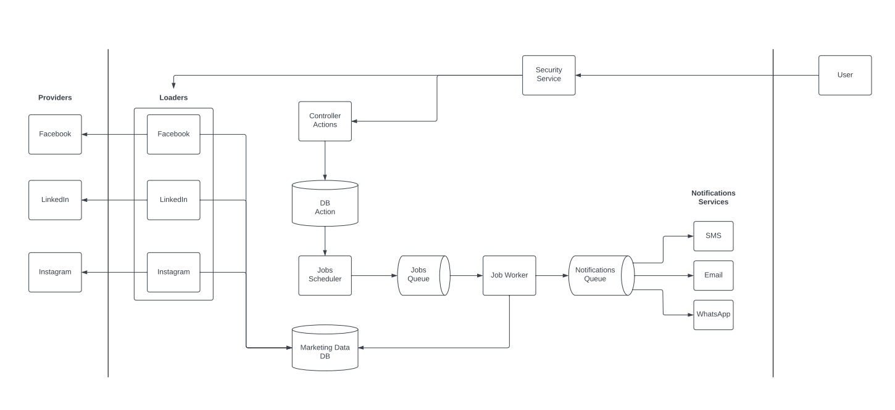

# Project Overview

**System Overview:**
The system comprises several key components working in harmony to execute marketing campaigns with precision and efficiency.

1. **Jobs Scheduler:** Orchestrates task execution on an hourly basis, identifying actions scheduled for the current hour and day of the week, and seamlessly integrating them into the execution queue for processing.

2. **Job Worker:** Retrieves tasks from the queue, evaluates conditions against the Marketing Data DB, and ensures that predefined thresholds are met before forwarding qualified actions into the notification queue.

3. **Notification Services:** Facilitates seamless delivery of notifications through various channels such as SMS, Email, and WhatsApp. It retrieves actions from the queue based on their types and delivers customized notifications with precision.

4. **campaign-advisor-client:** Empowers user interaction with a sleek front end crafted with React. The intuitive design enhances user experience, facilitating seamless interaction with the system's functionalities.
